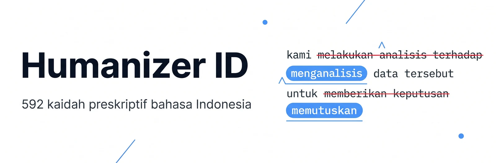
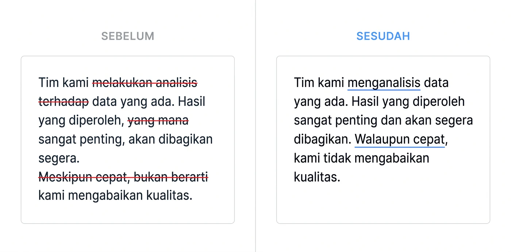

<p align="center">
  <picture>
    <source media="(prefers-color-scheme: dark)" srcset="assets/banner-dark.webp">
    <source media="(prefers-color-scheme: light)" srcset="assets/banner-light.webp">
    
  </picture>
</p>

<div align="center">

# Humanizer ID

**Panduan penyuntingan bahasa Indonesia akademik & profesional untuk agen AI**

<code>pip install humanizer-id</code>

[Instalasi](#instalasi) · [Arsitektur](#arsitektur-skill) · [Mode Kerja](#mode-kerja) · [Sebelum & Sesudah](#sebelum--sesudah) · [Cheat Sheet](#lembar-sontekan-diksi--kalke) · [FAQ](#faq) · [Changelog](CHANGELOG.md)

[](https://github.com/apissaj/humanizer-id/actions/workflows/ci.yml)
[](https://pypi.org/project/humanizer-id/)
[](https://github.com/apissaj/humanizer-id/releases)
[](https://skills.sh/apissaj/humanizer-id)
[](LICENSE)

</div>

---

**Humanizer ID** adalah buku aturan yang dibaca agen AI setiap sesi penyuntingan naskah Indonesia. Ia membersihkan kalke terjemahan mesin, nominalisasi bertumpuk, verba ringan, fragmentasi kalimat, dan pola khas keluaran LLM — lalu berhenti di situ: pembersih pola, bukan penentu gaya. 618 kaidah preskriptif bersumber dokumen resmi lengkap nomor halaman. Satu induk + lima sub-kaidah dimuat sesuai kebutuhan naskah, plus mesin audit deterministik ber-CLI. Integritas ilmiah mengikat: nol fabrikasi data, dan ini **bukan** alat bypass detektor AI.

## Sebelum & Sesudah

<a href="assets/compare/before-after.webp"></a>

Contoh penyuntingan abstrak penelitian teknik (studi kasus lengkap di [examples/](examples/)):

| **Sebelum: draf mentah AI** | **Sesudah: Humanizer ID** |
|:--|:--|
| *Di era digital saat ini, optimasi basis data merupakan hal yang sangat krusial. Dalam penelitian ini melakukan analisis terhadap performa indeks B-Tree yang mengalami peningkatan kecepatan sebesar 35%. Meskipun cepat, bukan berarti indeks ini tanpa cela. Tulisan ini membahas bagaimana implementasi partisi tabel memberikan pengaruh terhadap throughput transaksi yang mana sangat penting untuk sistem.* | *Optimasi basis data menjadi penentu efisiensi sistem berskala besar. Penelitian ini menganalisis performa indeks B-Tree yang mencatatkan peningkatan kecepatan hingga 35%. Kendati demikian, karakteristik beban kerja tetap memunculkan tantangan komputasi tersendiri. Pada penelitian ini dibahas implementasi partisi tabel untuk meningkatkan throughput transaksi secara berkelanjutan.* |

Yang dibersihkan: nominalisasi bertumpuk (*melakukan analisis terhadap*), kalimat tanpa subjek (*Dalam penelitian ini melakukan*), penyangkalan antisipatif (*Meskipun cepat, bukan berarti*), pronomina relatif salah (*yang mana*), personifikasi dokumen (*Tulisan ini membahas*).

## Mengapa Naskah AI Bahasa Indonesia Terasa Kaku?

Kekakuan jarang disebabkan kesalahan tata bahasa. Penyebab utamanya:

1. **Nominalisasi menumpuk & verba ringan** — *melakukan pengujian terhadap* alih-alih *menguji*.
2. **Kalke (*calque*) terjemahan mesin** — model berpikir dalam Inggris lalu menerjemahkan klausa demi klausa (*respecting boundaries* menjadi *menghormati batas*).
3. **Penyangkalan antisipatif** — *Meskipun X, bukan berarti Y...* yang menyangkal hal yang tak ditanyakan pembaca.
4. **Fragmentasi kalimat monoton** — kalimat pendek satu klausa berderet patah-patah (*staccato*).
5. **Monotoni pembuka antar-paragraf** — *Selain itu,... Lebih lanjut,... Oleh karena itu,...* berulang di tiap paragraf.
6. **Transisi kopong** — *Dengan demikian, hal ini membuktikan...* tanpa premis data yang cukup.

## Arsitektur Skill

Sejak v2.1.0 panduan editorial dipecah agar hemat konteks agen: induk dimuat dulu, sub-kaidah hanya yang relevan dengan naskah.

| Skill | Cakupan | Muat untuk |
|-------|---------|------------|
| **`SKILL.md`** (induk) | Aturan integritas ilmiah, pengecualian dokumen, 4 mode eksekusi, eliminasi penyakit AI leksikal, tabel rute, Delivery Gate | Semua naskah. Selalu dimuat |
| [skills/humanizer-id-sintaksis](skills/humanizer-id-sintaksis/SKILL.md) | 21 blok: kesejajaran, korelatif, kalimat efektif, morfofonemik verba | Naskah berkalimat cacat |
| [skills/humanizer-id-wacana-retorika](skills/humanizer-id-wacana-retorika/SKILL.md) | 18 blok: kohesi paragraf, sitasi terajut, hedging epistemik | Naskah alur lemah |
| [skills/humanizer-id-ejaan-morfologi](skills/humanizer-id-ejaan-morfologi/SKILL.md) | 17 blok: EYD V, PUEBI, peluluhan fonem, gabungan kata | Naskah ejaan/imbuhan |
| [skills/humanizer-id-diksi-istilah](skills/humanizer-id-diksi-istilah/SKILL.md) | 13 blok: pilihan kata, peristilahan PUPI, padanan lintas bidang | Naskah istilah teknis |
| [skills/humanizer-id-naskah-resmi](skills/humanizer-id-naskah-resmi/SKILL.md) | 6 blok: bahasa pewara, surat dinas, metadata jurnal | Naskah resmi/dinas |
| [jurnal/](jurnal/SKILL.md) | Modul jurnal bereputasi: IMRaD, checklist 28 poin, template abstrak/cover letter | Naskah Scopus/SINTA |

Arsip provenance sesi bedah tersimpan di [references/log-integrasi-kaidah.md](references/log-integrasi-kaidah.md) (bukan aturan operasional). Setiap entri kaidah berformat **Pola → Perbaikan → Sebab** dengan sitasi halaman sumber.

## Mode Kerja

Humanizer ID berjalan dua cara:

- **During** — membimbing penyuntingan selagi naskah dikerjakan, ditutup laporan Delivery Gate (PASS/FAIL).
- **After** — mengaudit naskah yang sudah ada: daftar temuan bernomor, kamu setujui nomor mana yang dieksekusi, lalu laporan susulan.

```bash
# Audit bernomor tanpa menyunting naskah
python scripts/audit.py naskah.md --report
```

Laporan tersimpan di `humanizer/audit-001-YYYY-MM-DD.md` (nomor naik otomatis, tak pernah menimpa). Tiap temuan memuat prioritas **HIGH** (kalke/verba ringan/klise AI), **MEDIUM** (istilah tak baku), **LOW** (gaya/domain), kutipan, saran, dan catatan kaidah.

## Instalasi

### Paket Python (PyPI)

```bash
pip install humanizer-id
```

```bash
# Audit naskah langsung
humanizer-id naskah.md

# Perbaikan otomatis (autofix) leksikal deterministik
humanizer-id naskah.md --fix            # ke layar
humanizer-id naskah.md --fix --write    # in-place ke berkas asli

# Preset domain spesifik
humanizer-id naskah.md --preset akademik
humanizer-id surat.md --preset dinas

# Teks demo bawaan
humanizer-id --demo
```

Sebagai modul Python:

```python
from humanizer_id.audit import load_default_data, audit_text

kalke, glos = load_default_data()
findings = audit_text("Naskah yang ingin diperiksa...", kalke, glos)
for f in findings:
    print(f["id"], "-", f["pola"])
```

### AI Coding Agents

#### skills.sh (rekomendasi)

Humanizer ID terdaftar di [skills.sh](https://skills.sh/apissaj/humanizer-id), direktori terbuka skill agen:

```bash
npx skills add apissaj/humanizer-id
```

#### Installer paket (alternatif)

Bila paket Python sudah terpasang, satu perintah memasang skill ke semua agen AI terdeteksi (Hermes Agent, Claude Code, Google Antigravity):

```bash
humanizer-id install
```

Opsi: `--target hermes|claude|antigravity` (pilih satu), `--with-references` (sertakan ekstrak buku), atau argumen path repo sendiri. Perintah ini menyalin `SKILL.md`, `skills/`, `scripts/`, `humanizer_id/`, dan `data/` — lengkap agar mode AFTER (`--report`) langsung jalan.

#### Manual

<details>
<summary>Klik untuk langkah salin manual per agen</summary>

```bash
# Hermes Agent
mkdir -p ~/.hermes/skills/creative/humanizer-id
git clone https://github.com/apissaj/humanizer-id.git /tmp/humanizer-id
cp /tmp/humanizer-id/SKILL.md ~/.hermes/skills/creative/humanizer-id/
cp -r /tmp/humanizer-id/skills/ ~/.hermes/skills/creative/humanizer-id/skills/
cp -r /tmp/humanizer-id/scripts/ /tmp/humanizer-id/humanizer_id/ /tmp/humanizer-id/data/ ~/.hermes/skills/creative/humanizer-id/

# Claude Code
git clone https://github.com/apissaj/humanizer-id.git ~/.claude/skills/humanizer-id

# Google Antigravity (global)
git clone https://github.com/apissaj/humanizer-id.git ~/.gemini/config/skills/humanizer-id
```

</details>

### Antarmuka Web (ChatGPT, Claude, Gemini)

Tanpa coding agent: salin [PROMPT.md](PROMPT.md) ke Custom Instructions (ChatGPT) atau Project System Prompt (Claude). Untuk skripsi & jurnal ilmiah (SINTA/Scopus), pakai [PROMPT-AKADEMIK.md](PROMPT-AKADEMIK.md) agar tone padat leksikal, berstruktur hipotaktis, dan impersonal murni.

### CLI Auditor Mandiri

Tanpa dependensi eksternal (100% pustaka standar Python):

```bash
python scripts/audit.py --demo
python scripts/audit.py path/ke/naskah.md
python scripts/audit.py naskah.md --preset akademik
```

## Sumber Resmi

Seluruh kaidah **bukan karangan bebas** — setiap aturan ditelusuri dari dokumen resmi dengan nomor halaman, tersimpan penuh di [references/](references/):

| Sumber | Kontribusi |
|--------|-----------|
| *Cerdas Cergas Berbahasa dan Bersastra Indonesia* Kelas XI & XII (Kemendikbudristek, 2024) | Ragam ilmiah denotatif-objektif, kalimat efektif, kaidah surat resmi (hlm. 210-215, 29-34) |
| *Bahasa Indonesia untuk Perguruan Tinggi* (Suyatno dkk., UIN Jakarta, 2017) | Enam syarat keefektifan kalimat akademik (hlm. 100-107) |
| *Tata Bahasa Baku Bahasa Indonesia* Edisi IV (Alwi dkk.) | Kesejajaran predikat, korelatif, pronomina, pelesapan konstituen |
| EYD Edisi V (SK No. 0424/I/BS.00.01/2022) & PUEBI | Peluluhan KTSP, bentuk terikat, gabungan kata |
| *Tata Istilah* (Pusat Bahasa 1978; Qodratillah 2019) | Paradigma imbuhan peristilahan, PUPI, padanan lintas bidang |
| *Bentuk dan Pilihan Kata* (Mustakim 2014, 2019) | Anti-pleonasme, diksi preskriptif, pembedaan dll./dsb./dst. |
| Seri Penyuluhan Badan Bahasa: *Kalimat*, *Paragraf* (2019) | Struktur kalimat efektif, kohesi paragraf |
| *Bahasa Indonesia untuk Pejabat Pemerintah* (Mullyana 2019); *Pedoman Surat-Menyurat* (1991) | Naskah dinas & surat resmi |
| *Bahasa Indonesia untuk Pewara* (Kurniawan dkk. 2019) | Naskah acara & penyapaan formal |
| Jurnal kebahasaan (Widyaparwa 2020, Genre UAD 2021, JPLED Unimal 2024, Ar-Rumman 2024) | Pleonasme skripsi, kontaminasi kuantor, korelatif takbaku |
| Kobak et al., *Science Advances* (2025, DOI: 10.1126/sciadv.adt3813) | Bukti frekuensi kalke verba AI: delve 28x, underscore 13,8x, showcase 10,7x |

Dataset terbuka di [data/](data/):

- [data/kalke-indonesia.json](data/kalke-indonesia.json) - 618 entri leksikon kalke, verba ringan, pola antisipatif AI, kaidah morfologi EYD V.
- [data/glosarium-lintas-bidang.json](data/glosarium-lintas-bidang.json) - 137 padanan istilah baku (Teknologi 59, Bisnis 44, Linguistik 17, Hukum 10, Jurnalistik 7).
- [data/pedoman-kampus.json](data/pedoman-kampus.json) - preset 16 perguruan tinggi + jurnal dikbud.

## Preset Kampus

Konvensi tugas akhir/skripsi spesifik (panduan lengkap: [references/panduan-preset-kampus.md](references/panduan-preset-kampus.md)). Cara pakai: sebutkan nama kampus saat memberi naskah, misalnya *Sunting abstrak skripsi ini dengan preset ugm*.

| Preset | Perguruan Tinggi | Sitasi Bawaan | Kaidah Khusus |
|--------|------------------|---------------|---------------|
| `ui` | Universitas Indonesia | APA / IEEE | Abstrak dwibahasa; penomoran tabel per bab (Tabel 1.1) |
| `itb` | Institut Teknologi Bandung | IEEE / Harvard | Rujukan persamaan (1.1); sampul minimalis |
| `ugm` | Universitas Gadjah Mada | IEEE / APA | Format Persamaan (nomor); Simpulan vs Saran terpisah tegas |
| `its` | Institut Teknologi Sepuluh Nopember | IEEE | Tinjauan pustaka state-of-the-art 5 tahun; margin 3-2.5-3-2 cm |
| `ipb` | IPB University | Name-Year | Sub-bab tanpa titik akhir (1.1 Latar Belakang); nama ilmiah miring |
| `undip` | Universitas Diponegoro | IEEE / APA | Judul bab kapital tebal di tengah; pasif metodologi |
| `unpad` | Universitas Padjadjaran | APA / Chicago | Abstrak maks 250 kata, satu paragraf spasi tunggal |
| `unair` | Universitas Airlangga | Vancouver / APA | Sitasi bernomor biomedis vs sosial-humaniora |
| `ub` | Universitas Brawijaya | IEEE / APA | Larangan konjungsi awal kalimat; paragraf min 2 kalimat |
| `telkom` | Telkom University | IEEE | Format artikel IEEE; sitasi GitHub & dataset publik |
| `udinus` | Universitas Dian Nuswantoro | IEEE / APA | Black-box testing & pengujian pengguna; kode monospace |
| `uns` | Universitas Sebelas Maret | APA / IEEE | Bab romawi, sub-bab desimal; abstrak dwibahasa 200-250 kata |
| `unnes` | Universitas Negeri Semarang | APA 7th | Desimal tanpa titik akhir sub-bab; kutipan >40 kata indent 1.2 cm |
| `upi` | Universitas Pendidikan Indonesia | APA 7th | Analisis Data & Pembahasan terpisah dari Temuan |
| `unhas` | Universitas Hasanuddin | Harvard / Vancouver / IEEE | Nomor halaman bab di tengah bawah; wajib terjemahan kutipan asing |
| `unand` | Universitas Andalas | APA / Harvard | Abstrak satu paragraf tanpa indent; rujukan persamaan (1.1) |
| `jurnal-dikbud` | Jurnal Pendidikan & Kebudayaan Kemendikbud | Nama-tahun | Verdana 9 spasi 1; judul maks 14 kata; abstrak 150-200 kata |
| `jurnal-jipp` | Jurnal Inovasi & Perekayasa Pendidikan | Alfabetis-Kronologis | Abstrak dwibahasa 100-150 kata; 5 kata kunci; 15-20 hlm kuarto |

## Lembar Sontekan Diksi & Kalke

Padanan cepat membersihkan tulisan AI dan birokratis:

| Pola AI / Kaku | Bentuk Luwes & Lugas | Jenis Masalah |
|---|---|---|
| melakukan pengukuran terhadap | mengukur | Verba ringan |
| melakukan analisis terhadap | menganalisis | Verba ringan |
| memberikan pengaruh terhadap | memengaruhi | Verba ringan |
| mengalami peningkatan sebesar | meningkat / naik sebesar | Nominalisasi |
| menghormati batas sistem | selaras dengan batas sistem | Kalke (respecting boundaries) |
| menghapus limbah | meniadakan / meminimalkan limbah | Kalke (eliminate waste) |
| tidak datang tanpa harga | bukan tanpa konsekuensi / kendala | Kalke (not without a price) |
| Makalah ini membahas... | Pada makalah ini dibahas... | Personifikasi dokumen |
| ...yang mana sangat penting | ...yang penting / sehingga penting | Pronomina relatif salah |
| X, bukan berarti Y | Kendati X, tantangan Y tetap... | Penyangkalan antisipatif |

## Prinsip Integritas Ilmiah

- **Nol fabrikasi data** - tidak menambah angka, parameter uji, atau sitasi baru yang tak ada di draf asli.
- **Safeguard pasif ilmiah** - kalimat pasif pada Metodologi dan Hasil adalah konvensi resmi sains Indonesia; tidak diubah agresif.
- **Zona terlarang disunting** - instrumen tervalidasi (kuesioner/Likert), dokumen kontrak, dan paten hukum tak disentuh.
- **Bukan alat bypass deteksi** - fokus pada keterbacaan manusia; kelancaran tata bahasa bukan jaminan skor detektor AI statistik.

## FAQ

**Apakah ini alat bypass detektor AI?**
Bukan. Humanizer ID membersihkan pola tulisan AI agar terbaca manusiawi dan profesional; ia tidak menargetkan skor detektor statistik.

**Apakah bisa dipakai offline?**
Ya. CLI auditor 100% pustaka standar Python tanpa dependensi; seluruh kaidah tersimpan lokal di data/ dan references/.

**Apa bedanya dengan alat penyunting naskah AI generik?**
Humanizer ID khusus bahasa Indonesia: 618 kaidah preskriptif bersumber dokumen resmi dengan nomor halaman, bukan penyaring gaya generik.

**Apa itu sub-kaidah (skill)?**
Folder berisi SKILL.md yang memperdalam satu ranah (ejaan, sintaksis, diksi, wacana, naskah resmi). Sub-kaidah merujuk kaidah induk lewat ID (mis. TBB-021) dan tidak pernah menduplikasinya - menambah satu tak mengubah induk.

**Agen apa saja yang didukung?**
Semua agen pembaca SKILL.md: Hermes Agent, Claude Code, Google Antigravity, dan antarmuka web via PROMPT.md.

## Lisensi

MIT: [LICENSE](LICENSE) © 2026 [Hafizh Muzani](https://github.com/apissaj) · Riwayat perubahan: [CHANGELOG.md](CHANGELOG.md)

